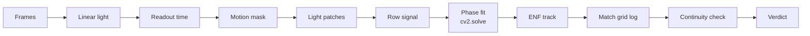
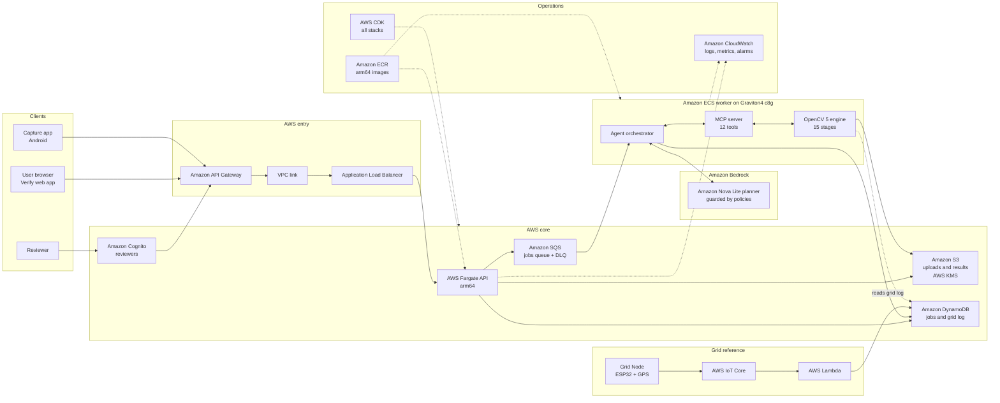
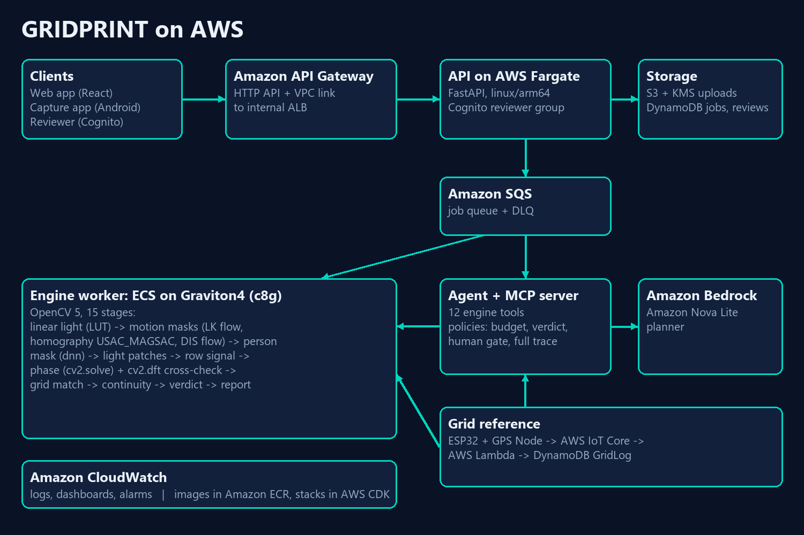
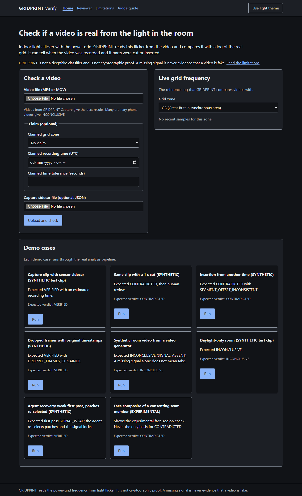
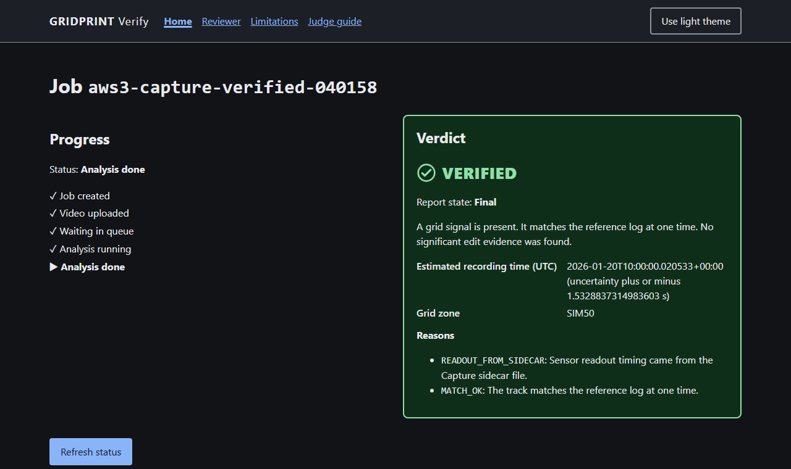
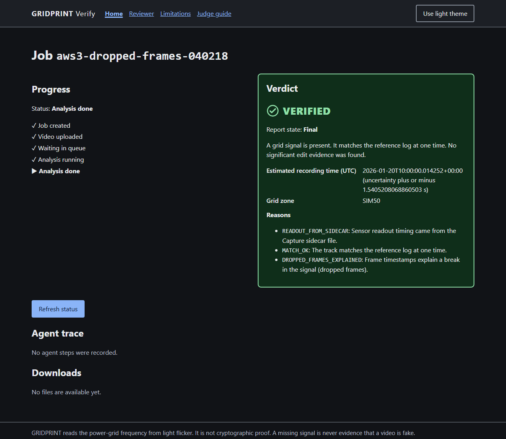
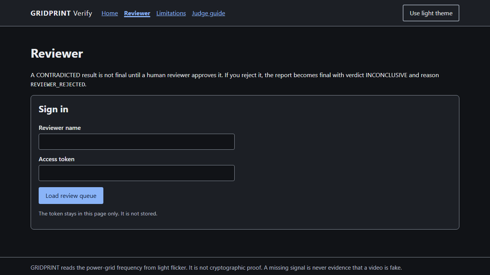

<div align="center">

# GRIDPRINT

**Checks that a video is real by reading the power grid in the flicker of the room lights.**

[](https://github.com/vivekyarra/Alibi/actions/workflows/ci.yml)
[](LICENSE)
[](pyproject.toml)
[](https://opencv.org/)
[](infra/)
[](bench/)

**[Live app](https://5u7suz00bi.execute-api.us-east-1.amazonaws.com)** ·
**[Judge guide](docs/JUDGE_GUIDE.md)** ·
**[Technical report](docs/TECHNICAL_REPORT.md)** ·
**[Architecture](docs/ARCHITECTURE.md)** ·
**[Responsible use](docs/RESPONSIBLE_USE.md)**

*Entry for the OpenCV AI Competition 2026 (OpenCV 5 + AWS).*

</div>

---

## The problem

Anyone can now make a video that looks real. Viewers, newsrooms and courts need a way to check a recording that
does not depend on trusting the person who sent it. Most tools guess from how pixels look. GRIDPRINT uses a
physical witness instead: the electric grid.

## The idea

Mains-powered lights flicker at twice the grid frequency. The grid frequency drifts a little all the time, and the
drift is the same across the whole grid. This drift is the electric network frequency (ENF). A phone camera with a
rolling shutter reads the sensor one row at a time, so the flicker shows as faint horizontal bands in the video.
GRIDPRINT reads those bands with OpenCV 5, rebuilds the ENF track, and compares it with a recorded log of the real
grid.

The result is always one of three verdicts:

| Verdict | Meaning |
|---|---|
| `VERIFIED` | The flicker in the video matches the grid log for the claimed time and place. |
| `CONTRADICTED` | The flicker clearly disagrees with the grid log. Final only after a human reviewer approves it. |
| `INCONCLUSIVE` | The signal is too weak or absent to decide. A missing signal never counts against a video. |

GRIDPRINT is not an AI-content detector and is not cryptographic proof. It gives evidence, with every step traced.

## How it works

1. **Capture.** Record with any phone, or with the GRIDPRINT Capture Android app, which saves a sidecar file with
   the camera timing.
2. **Upload.** Send the video to the Verify web app. The file goes to Amazon S3 and a job goes on Amazon SQS.
3. **Analyze.** A Graviton4 worker runs the OpenCV 5 engine. An agent on Amazon Bedrock picks the next engine tool.
   Code-enforced policies keep the verdict deterministic.
4. **Decide.** The engine matches the ENF track to the grid log and returns a verdict, a PDF report, plots and the
   full agent trace.

### Per-video pipeline



All signal math runs in float32 or float64 on linear light. The engine never interpolates across the rolling-shutter
idle gap between frames.

## Architecture



**9 AWS CDK stacks are deployed** in `us-east-1`. The API runs on AWS Fargate `linux/arm64`; the engine workers
run on Graviton4 `c8g` instances fed by Amazon SQS. Full detail: [docs/ARCHITECTURE.md](docs/ARCHITECTURE.md) and
technical report §6.

<details>
<summary>Architecture poster (image)</summary>



</details>

## Key results

### Live on AWS

- **Real iPhone 13 recording on the live deployment:** job `cd65b6ea0c20` ran end to end on a Graviton4 worker. The
  stock camera app's anti-banding had removed the flicker bands, so the engine reported `INCONCLUSIVE`
  (`SIGNAL_ABSENT`) instead of guessing, and the agent adapted by asking for the original file and the camera model. <!-- src: results/aws/index.json#cd65b6ea0c20.verdict -->
- **Every step is traced:** each AWS run stores its result, agent trace, report PDF and plots under `results/aws/`
  (`results/aws/<job_id>/trace.json`).

### Graviton4 vs x86 (stock OpenCV 5.0.0, `results/bench/2026-10-27/`)

| Metric | x86 `c7i.2xlarge` | Graviton4 `c8g.2xlarge` |
|---|---|---|
| Throughput, video-s per wall-s | 0.92 <!-- src: results/bench/2026-10-27/A/summary.json#throughput_video_s_per_wall_s --> | 1.20 <!-- src: results/bench/2026-10-27/B/summary.json#throughput_video_s_per_wall_s --> |
| Cost per video-hour | $0.390 <!-- src: results/bench/2026-10-27/cost.json#configs.A.cost_per_video_hour_usd --> | $0.266 <!-- src: results/bench/2026-10-27/cost.json#configs.B.cost_per_video_hour_usd --> |

Same engine, same input, five runs per configuration. Graviton4 processes more video per second at a lower cost per
hour of video (technical report §7).

### Evaluation

- **0 false `CONTRADICTED`** on authentic clips of the frozen-threshold test split (SYNTHETIC simulator clips). <!-- src: results/eval/2026-10-27-test/synthetic-v1-fallback/summary.json#test.false_contradicted_rate -->
- Agent traces for each behaviour: `results/agent_traces/`.
- Full SYNTHETIC tables and the real-recording runs: technical report §9.

SYNTHETIC results are labeled SYNTHETIC and are never presented as real-world accuracy. Every reported number
lives under `results/` with a source tag (SPEC 14.3).

## The app

| Upload and verify | Job result |
|---|---|
|  |  |
| **Agent trace** | **Reviewer view** |
|  |  |

## Tech stack

| Layer | Technology |
|---|---|
| Vision engine | OpenCV 5 (`cv2.LUT`, `calcOpticalFlowPyrLK`, `findHomography` USAC_MAGSAC, `DISOpticalFlow`, `cv2.dnn`, `warpPerspective`, `cv2.solve`, `cv2.dft`), NumPy, PyAV |
| Agent | Amazon Bedrock (Amazon Nova Lite), Model Context Protocol server `gridprint-engine`, code-enforced policies |
| API and web | FastAPI on AWS Fargate arm64, React web app |
| Compute | Amazon ECS on Graviton4 `c8g`, Amazon SQS |
| Data | Amazon S3 with AWS KMS, Amazon DynamoDB |
| Identity and ops | Amazon Cognito, Amazon CloudWatch, Amazon ECR, AWS CDK v2 |
| Edge hardware | Grid Node (ESP32 + GPS) through AWS IoT Core and AWS Lambda; Capture Android app (Camera2) |

## Quick start

Requirements: Python 3.11, [uv](https://docs.astral.sh/uv/), FFmpeg on `PATH`, Node.js 24 (for the web app).

```bash
make setup                         # install dependencies
python -m eval.make_demo_inputs    # create sample input videos
make local                         # serve API + web app at http://127.0.0.1:8000
```

`make local` uses local file storage and the deterministic agent planner. The reviewer token for local use is
written to `work/local_reviewer_token.txt`. On Windows without GNU make, use `./make <target>` (Git Bash) or
`make.cmd <target>`.

More commands:

```bash
make test          # unit and integration tests
make eval          # evaluation (SYNTHETIC split)
make bench         # Graviton vs x86 benchmark
make final-check   # prints ALL CHECKS PASSED only when every SPEC 17.3 item holds
```

### Deploy to AWS

1. Complete human task H1 in [docs/HUMAN_TASKS.md](docs/HUMAN_TASKS.md) (CLI profile `gridprint`).
2. Build the arm64 images (no local Docker needed): `python infra/build_images.py`.
3. Deploy all stacks: `make deploy`. Remove everything: `make destroy`.

## Repository structure

```text
engine/            OpenCV 5 engine, stages S1-S15 (engine/gridprint_engine/)
agent/             Agent planner, policies and trace
mcp_server/        MCP tool server gridprint-engine
api/               FastAPI service and job worker
web/               Verify web app (React)
infra/             AWS CDK v2 stacks and image build
eval/              Simulator, datasets and evaluation
bench/             Graviton vs x86 benchmark
capture-android/   Capture Android app
node/              Grid-frequency Node: hardware, firmware, ingest
calibration_rig/   Camera calibration rig
docs/              Report, architecture, guides, build logs
results/           Every reported number, with its source
```

## Documentation

| Document | What it covers |
|---|---|
| [Technical report](docs/TECHNICAL_REPORT.md) | Method, AWS design, benchmark and evaluation in full |
| [Architecture](docs/ARCHITECTURE.md) | Components, data flow and diagrams ([docs/diagrams/](docs/diagrams/)) |
| [Judge guide](docs/JUDGE_GUIDE.md) | Step-by-step walkthrough of the live app |
| [Responsible use](docs/RESPONSIBLE_USE.md) | How to use GRIDPRINT verdicts correctly |
| [SPEC.md](SPEC.md) | The single source of truth for the product |

For reviewers who want the full trail, the build logs are also in `docs/`:
[PROGRESS](docs/PROGRESS.md), [DECISIONS](docs/DECISIONS.md), [VERIFICATION](docs/VERIFICATION.md),
[REQUIREMENTS_TRACE](docs/REQUIREMENTS_TRACE.md) and [HUMAN_TASKS](docs/HUMAN_TASKS.md).

## Responsible use

A verdict is evidence, not a final judgment. `CONTRADICTED` always needs a human reviewer. Read
[docs/RESPONSIBLE_USE.md](docs/RESPONSIBLE_USE.md) before you use GRIDPRINT results in any decision.

## Acknowledgements

Built for the OpenCV AI Competition 2026 with OpenCV 5 and AWS. Thanks to the OpenCV team and the AWS Graviton,
Amazon Bedrock and AWS CDK teams for the tools this project stands on.

## License

Licensed under `Apache-2.0`. See [LICENSE](LICENSE).
